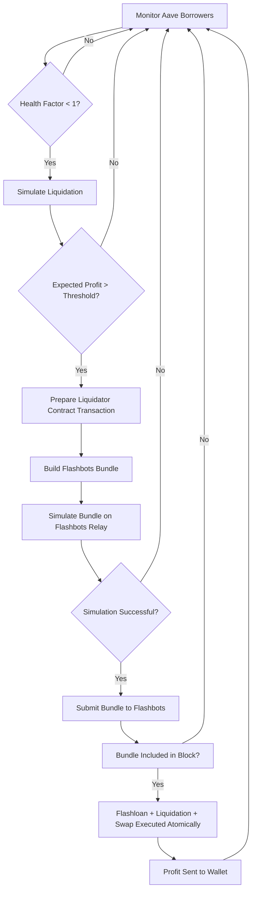
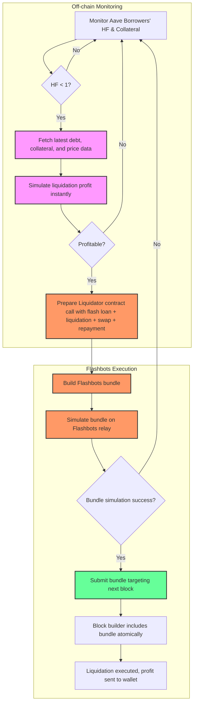

# Aave Liquidation Bot Concept Overview

## 1. Concept

This document outlines the concept and workflow for building a **profitable Aave liquidation bot**. The goal is to detect unhealthy borrowers, perform liquidations efficiently, and maximize profits while minimizing risk using advanced Ethereum tooling like **flash loans** and **Flashbots**.

---

## 2. Liquidation Basics

- **Aave borrowers** must maintain a **health factor (HF) > 1**.
- If HF drops below 1, the position becomes liquidatable.
- A liquidator can repay part of the debt and seize collateral, earning a bonus.

**Key challenge:** liquidations are **time-sensitive** and highly competitive. Other bots may front-run naive attempts, making profitability unreliable.

---

## 3. Flash Loans

- A **flash loan** is an uncollateralized loan executed within a single transaction.
- Steps:
  1. Borrow funds via Aave or another provider.
  2. Use the funds to perform liquidation.
  3. Swap seized collateral to repay the loan.
  4. Keep any leftover profit.
- **Advantages:** You don’t need upfront capital.  
- **Critical:** The entire process must occur **atomically**; if any step fails, the transaction reverts and the loan is canceled.

---

## 4. Simulating Liquidations

Before executing real transactions:

1. **Fetch real-time data:**
   - Borrower’s HF
   - Debt amounts
   - Collateral prices
   - Gas price and gas estimates
2. **Calculate potential profit**:
   - Expected seized collateral
   - Swap slippage
   - Flash loan fees
   - Gas costs
3. **Decide whether to attempt liquidation**:
   - Skip unprofitable or high-risk candidates
4. **Re-run simulation** right before sending to ensure data freshness.

This reduces **risk of wasted gas** and improves the reliability of your bot.

---

## 5. Using Flashbots

### 5.1 Problem

- Public mempool transactions are visible.
- Competitors can **front-run** your liquidation by bidding higher gas or copying your transaction.
- Failed or front-run transactions waste gas and reduce profits.

### 5.2 Solution: Flashbots

- Flashbots allow **private transaction bundles** to be sent directly to block builders.
- Features:
  - **Private submission:** No mempool visibility → no front-running.
  - **Atomic bundles:** Include multiple actions (flash loan → liquidation → swap → repayment) in one transaction.
  - **Simulated inclusion:** Bundles are tested for success before mining.
  - **No gas wasted on failed attempts:** Transactions never broadcast if invalid.

### 5.3 Benefits for Liquidation Bot

| Problem | Flashbots Benefit |
|---------|-----------------|
| Front-running | Private bundle submission |
| Failed transactions | Zero gas cost if bundle not included |
| Atomic execution | Flash loan + liquidation + swap in one transaction |
| Gas wars | Predictable inclusion without auction |

---

## 6. Bot Workflow

1. **Monitor borrowers** on Aave for HF < 1.
2. **Simulate liquidation**:
   - Fetch current HF, debt, collateral, oracle prices.
   - Estimate gas cost and swap slippage.
   - Compute expected profit.
3. **Prepare bundle**:
   - Call `Liquidator.executeLiquidation(...)` (flash loan + liquidation + swap + repayment).
4. **Simulate bundle with Flashbots**.
5. **Submit bundle to Flashbots** if profitable.
6. **Reconcile result**:
   - Check profit realized
   - Update statistics
7. **Repeat** continuously for new liquidation opportunities.

---

## 7. Key Components

### 7.1 Solidity Liquidator Contract

- Handles **flash loan** from Aave.
- Executes **liquidation** call.
- Swaps **collateral** to repay loan.
- Sends **profit** to your wallet.
- Must implement **callback** required by Aave flash loans.

### 7.2 Flashbots Submission Script (Ethers.js)

- Builds and signs the transaction bundle.
- Simulates bundle on Flashbots relay.
- Sends to target block if simulation passes.
- Handles retries for multiple consecutive blocks.

---

## 8. Cost Considerations

- **Gas**:
  - Base fee is burned (unavoidable)
  - Priority fee is tip to builder (can be small in Flashbots)
- **Flash loan fees**: Typically <0.09% of loaned amount on Aave.
- **Slippage & swap fees**: Must be included in simulation to avoid negative profit.

**Example (Ethereum Mainnet):**
- Gas used: 1,150,000
- Base fee: 8 gwei
- Priority fee: 0.5 gwei
- Cost: 0.009775 ETH ≈ $29.33 (if ETH=$3,000)

---

## 9. Safety & Best Practices

- Always simulate before sending.
- Keep ETH balance to cover base fees.
- Use conservative slippage limits on swaps.
- Test extensively on **mainnet fork or testnet**.
- Be aware of legal/ethical considerations for MEV strategies.

---

## 10. Summary

- Build **simulator first** to identify profitable liquidations without risk.
- Use **flash loans** to fund liquidations without upfront capital.
- Use **Flashbots** to avoid front-running and atomicize transactions.
- Continuously monitor, simulate, and submit profitable bundles to maximize efficiency and profits.

# Liquidation Bot Workflow Diagram

## Key Parameters

| Parameter     | Typical Value | Notes                       |
| ------------- | ------------- | --------------------------- |
| Gas Used      | 1,100k–1,200k | depends on liquidation size |
| Base Fee      | 3–15 gwei     | Ethereum mainnet, dynamic   |
| Priority Fee  | 0–2 gwei      | Flashbots tip, usually low  |
| Flashloan Fee | 0.09%         | depends on Aave             |
| Swap Slippage | 0.5–1%        | set conservatively          |

