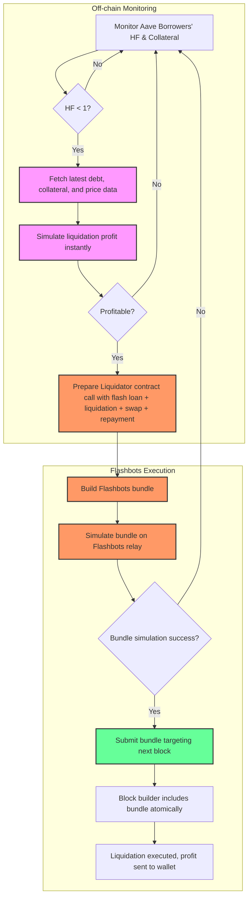

# Aave Liquidation Bot – Extended Concept Overview

## 1. Concept

This document outlines the design and workflow for building a profitable Aave liquidation bot. The goal is to detect unhealthy borrowers, perform liquidations efficiently, and maximize profits while minimizing risk using flash loans, Flashbots bundles, and low-latency Ethereum infrastructure.

Additionally, the project serves as a learning portfolio for Web3/DeFi engineering roles, demonstrating full-stack blockchain expertise: Solidity smart contracts, Rust off-chain logic, node infrastructure, and MEV strategies.

---

## 2. Liquidation Basics

* **Health Factor (HF)**: Borrowers must maintain HF > 1.
* **Liquidatable positions**: HF < 1.
* **Liquidation mechanics**: A liquidator can repay part of the debt and seize collateral, earning a bonus.
* **Challenge**: Liquidations are time-sensitive and highly competitive; other bots may attempt the same liquidations, especially in volatile markets.

---

## 3. Flash Loans

Flash loans allow borrowing assets without upfront capital if the loan is repaid within a single transaction.

**Steps:**

1. Borrow via Aave or another flash loan provider.
2. Perform liquidation.
3. Swap seized collateral to repay the loan.
4. Keep leftover profit.

> Entire process must be atomic; any failure reverts the transaction.
> **Decision:** Use flash loans to avoid using personal capital while executing liquidations.

---

## 4. Health Factor Monitoring & Off-Chain Computation

HF is **not an on-chain event** — it must be calculated from:

* Collateral balances
* Borrowed balances
* Oracle prices
* Asset liquidation thresholds

**Implementation:**

* Rust backend computes HF off-chain per block or on relevant events.
* Monitoring via WebSocket:

  * Subscribe to new block headers: `eth_subscribe("newHeads")`
  * Subscribe to Aave pool events: `Deposit`, `Withdraw`, `Borrow`, `Repay`
  * Optionally, subscribe to oracle price updates

**Workflow:**

1. WS subscription triggers on new block or relevant event.
2. Fetch borrower positions & prices.
3. Compute HF in Rust.
4. If HF < 1 → simulate liquidation.
5. Submit bundle via Flashbots if profitable.

---

## 5. Simulating Liquidations

Before sending real transactions:

1. Fetch real-time data:

   * Borrower HF, debt, collateral
   * Oracle prices
   * Gas price and estimate
2. Calculate potential profit:

   * Seized collateral
   * Swap slippage
   * Flash loan fees (<0.09%)
   * Gas cost
3. Decide whether to attempt liquidation (skip unprofitable or high-risk candidates).
4. Re-run simulation immediately before submission for data freshness.

> Minimizes wasted gas and avoids submitting unprofitable transactions.

---

## 6. Flashbots Integration

### 6.1 Problem

* Public mempool transactions can be front-run.
* Failed transactions waste gas.

### 6.2 Solution

* Submit private transaction bundles directly to block builders.

**Features:**

* Private bundle submission
* Atomic execution (flash loan → liquidation → swap → repayment)
* Simulated inclusion before mining
* No gas wasted if bundle fails

### 6.3 Considerations

* Flashbots prevent MEV frontrunning but not competition from other bots independently liquidating the same position.
* If your bundle is not included in the block, no gas is lost, but opportunity may be taken by others.

---

## 7. Bot Workflow

---

## 8. Key Components & Design Decisions

| Component                    | Purpose                                          | Design Notes                                                                 |
| ---------------------------- | ------------------------------------------------ | ---------------------------------------------------------------------------- |
| Solidity Liquidator Contract | Flash loan liquidation, swap, repay, send profit | Tested on mainnet fork/testnet; atomic execution                             |
| Rust Bot Logic               | HF calculation, simulation, bundle submission    | Uses WebSocket subscriptions for minimal latency; handles multiple borrowers |
| Ethereum Node (self-hosted)  | Provides real-time blockchain data               | VPS deployment near EU relays; hosts both bot & node for fastest querying    |
| VPS                          | Runs bot 24/7                                    | Near Frankfurt/Zurich for low-latency Flashbots access                       |
| Flashbots Relay              | Private bundle submission                        | Protects against frontrunning; atomic bundles; no gas wasted if rejected     |
| DEX / Swap Engine            | Convert seized collateral                        | Handles slippage, liquidity, swap fees                                       |
| Simulation Engine            | Estimate profit, gas, slippage                   | Filters only profitable opportunities                                        |
| Logging & Monitoring         | Track bot performance, errors, bundle inclusion  | Optional DB or dashboard for analytics                                       |
| Security & Key Management    | Safely store private keys                        | Use environment variables or secure vault                                    |

**Additional Considerations:**

* HF computed off-chain per block/event.
* Bundle submission via Flashbots to combat MEV.
* Bear markets → more HF < 1 → more liquidation opportunities.
* WebSocket preferred over HTTP for monitoring; HTTP optional for transaction submission.
* VPS co-located with node for near-instant access to blockchain data.
* Simulation + conservative thresholds reduce risk.

---

## 9. Cost Considerations

| Parameter     | Typical Value | Notes                       |
| ------------- | ------------- | --------------------------- |
| Gas Used      | 1,100k–1,200k | Depends on liquidation size |
| Base Fee      | 3–15 gwei     | Dynamic on Ethereum mainnet |
| Priority Fee  | 0–2 gwei      | Flashbots tip, usually low  |
| Flashloan Fee | 0.09%         | Aave standard               |
| Swap Slippage | 0.5–1%        | Conservative limits         |

> Simulation prevents negative profit due to fees/slippage.
> VPS, node hosting, and gas cost must be factored into operational expense.

---

## 10. Safety & Best Practices

* Always simulate before sending transactions.
* Maintain sufficient ETH balance for base fees.
* Use conservative slippage on swaps.
* Test extensively on mainnet fork/testnet.
* Be aware of legal/ethical considerations for MEV strategies.

---

## 11. Learning & Career Strategy

**Courses to complete before or during project:**

* Foundry (Solidity + testing)
* Aave protocol deep dive
* Uniswap protocol
* Rustlings (Rust mastery)

**Portfolio & Documentation Strategy:**

* Document progress on X (Twitter) for micro-updates.
* Use LinkedIn for milestone updates.
* Demonstrates:

  * Full-stack DeFi engineering
  * Solidity & Rust expertise
  * MEV, node management, low-latency optimization
  * Risk-aware, production-ready design

> Even without large profits, a fully-documented bot is portfolio-ready.

---

## 12. Execution Plan / Roadmap

1. Learn protocols & tooling: Foundry, Rust, Aave, Uniswap.
2. Implement read-only monitor:

   * Subscribe via WebSocket
   * Compute HF off-chain
   * Simulate liquidations
3. Develop Solidity liquidator contract:

   * Flash loan execution
   * Collateral swap + repay
4. Integrate Flashbots bundle submission:

   * Private, atomic transaction bundles
   * Simulate before sending
5. Deploy Ethereum node + Rust bot on VPS:

   * Minimize latency
   * Ensure 24/7 uptime
6. Implement logging, monitoring, and analytics dashboard.
7. Optimize:

   * HF computation batching
   * Gas & swap efficiency
   * Bundle submission timing
8. Document process publicly for learning/portfolio purposes.

